# Cappuccino

A free, ad-free illustration app for Android tablets, with a small companion that gives you art
direction while you work. Your artwork stays on your device, and the interface stays out of your
way until you need it.


Cappuccino is in active development and hasn't had a public release yet.

## Meet your companion

Most drawing apps give you tools and leave you alone with the hard questions. Is this reading
clearly? Are the values working? Am I getting closer to the look I'm after? Cappuccino's
companion is there for those moments, like a friend looking over your shoulder only when you
ask.

Choose a paint drop, ink blot, foam cup, or coffee drop:

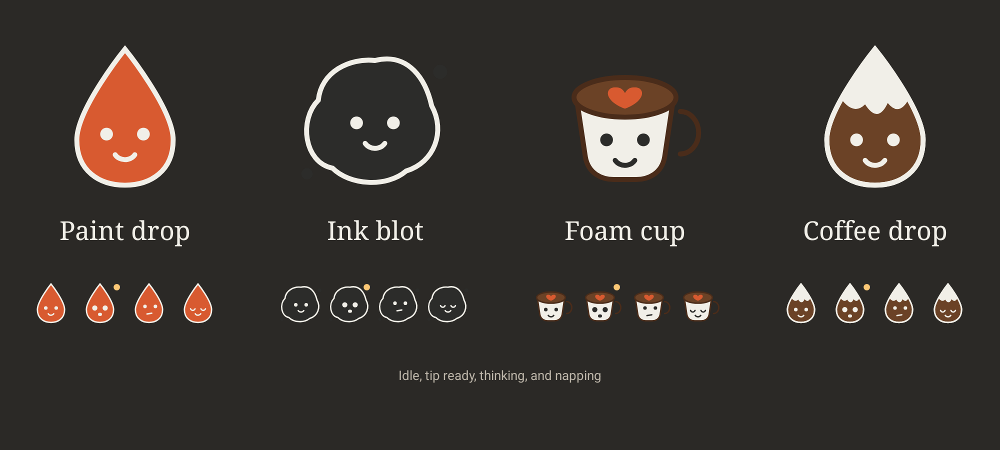

Your companion rests in a corner of the canvas and never interrupts you. When it has a thought, a
small dot appears beside it. Tap it to read the note, or keep drawing and ignore it. If you'd
rather be alone, it tucks away behind the toolbar.

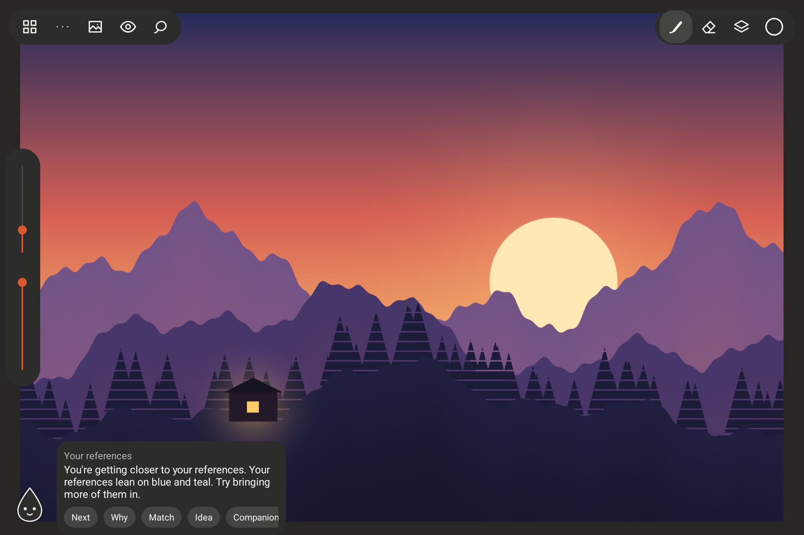

### It looks at your drawing

On any artwork, with no setup, the companion looks at your palette, values, composition,
silhouette, and mood, and suggests a next step for your sketch. Turn on a light direction or
perspective guides and it checks those too, including strokes that drift away from your
vanishing points.

### It compares with your references

Add reference images to a sketchbook and the companion measures how close your artwork is to
them. You get a score for palette, values, composition, and mood, plus colors to try from your
references.

You choose what it compares with. It uses your open references first, then your starred ones,
then your 40 newest. The note always says which set it used.

### It shows its reasoning

The companion never asks you to take its word for it. **Why** shows the measurements behind a
note, with previews of your values, your silhouette, or the closest reference side by side.

### It gives you ideas

When you're stuck, **Idea** suggests something to try, such as a texture pass, a bold accent
color, or a Multiply layer for shadows. **Try it** sets up the brush or color for you, so the idea
is one tap from the canvas.

| Why | Match | Idea |
|---|---|---|
| 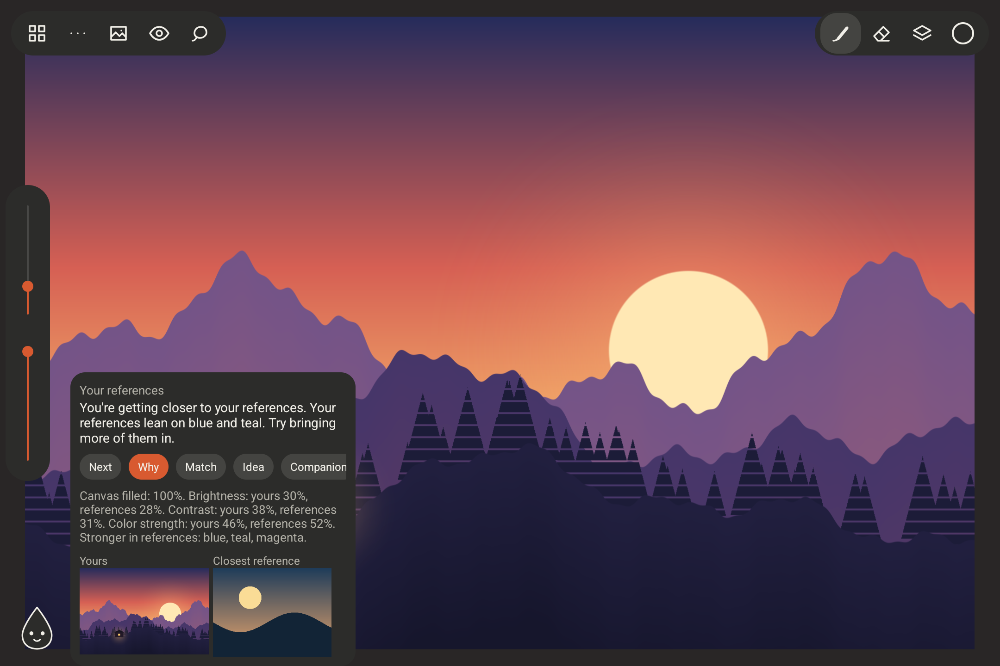 | 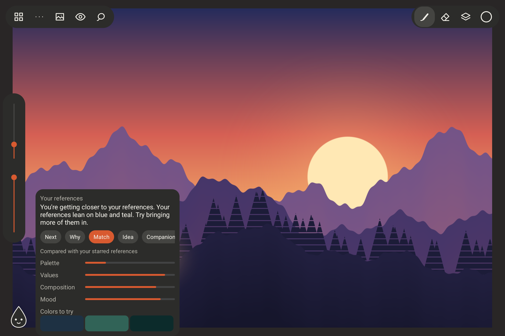 | 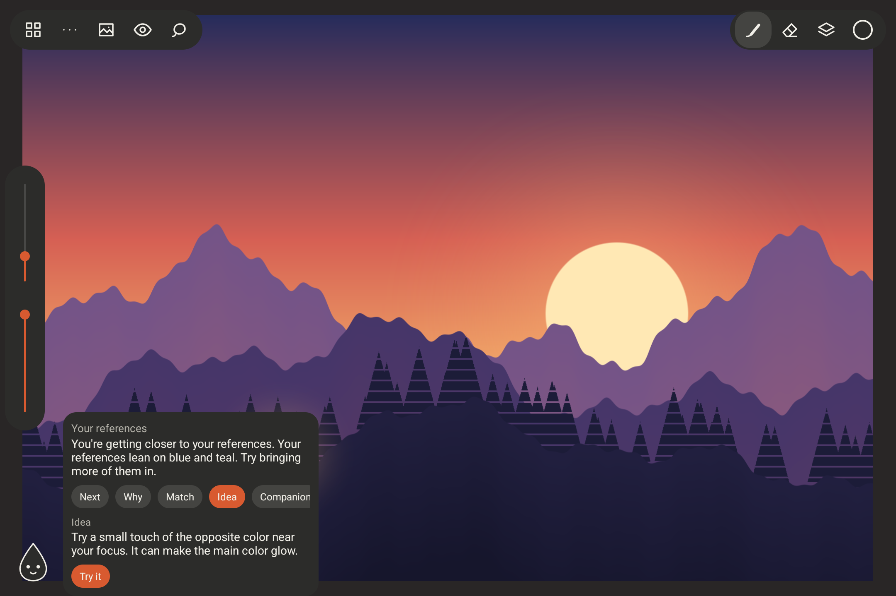 |

### It leaves your art to you

The companion runs entirely on your device with image analysis, not generative AI. Nothing is
uploaded, and it never draws or changes your work. It measures color, light, and shape, so it
can't recognize your subject or judge your style. Those decisions stay yours.

## Features

### Draw

- Fourteen brushes, including Sponge and Dry brush textures
- Scatter brushes for leaves, grass, rocks, and particles
- Smudge, fill, gradient, and lasso fill tools, plus a lasso eraser for blocking in silhouettes
- Hold at the end of a stroke to snap it to a clean line, ellipse, or box. Lines lean toward your perspective guides
- Live symmetry: left-right, top-bottom, four-way, or radial, with a center you can move
- Custom brushes with imported texture tips, favorites, a stabilizer, and an adjustable pressure curve
- Every brush shape also works as an eraser
- Low-latency stylus drawing with pressure, and tilt on pens that support it
- Hold the pen, or press its side button, to pick a color

| Brushes | Tools and snapping |
|---|---|
|  | 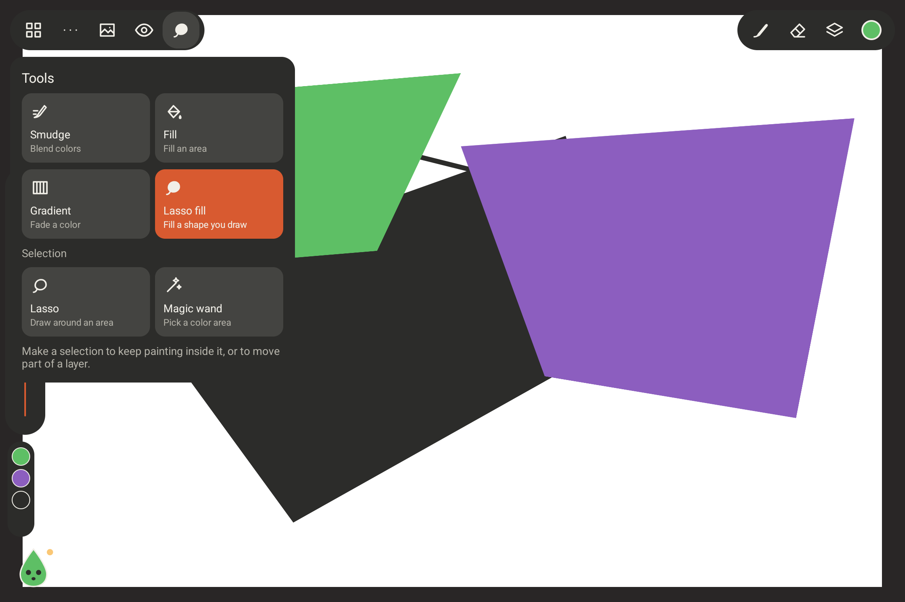 |

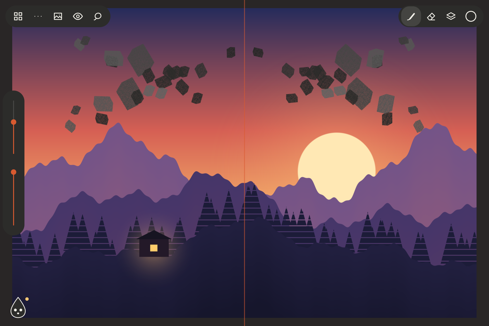

### Build your image

- Layers with blend modes, opacity, layer masks, clipping masks, transparency lock, and groups
- Liquify: push, grow, shrink, and restore parts of a layer
- Filters: blur, motion blur, sharpen, noise, gradient map, levels, and depth fade
- Lasso and magic wand selections, transform, and hue, saturation, and tone adjustments
- One undo history for strokes and layer changes
- Canvas presets for screen, print, and video, or custom sizes up to 8192 pixels

| Layers | Layer tools |
|---|---|
|  | 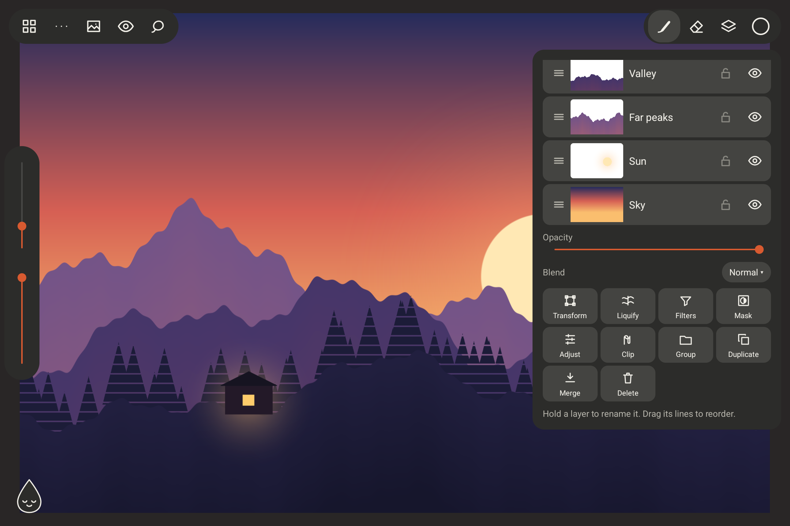 |

| Liquify | Filters |
|---|---|
| 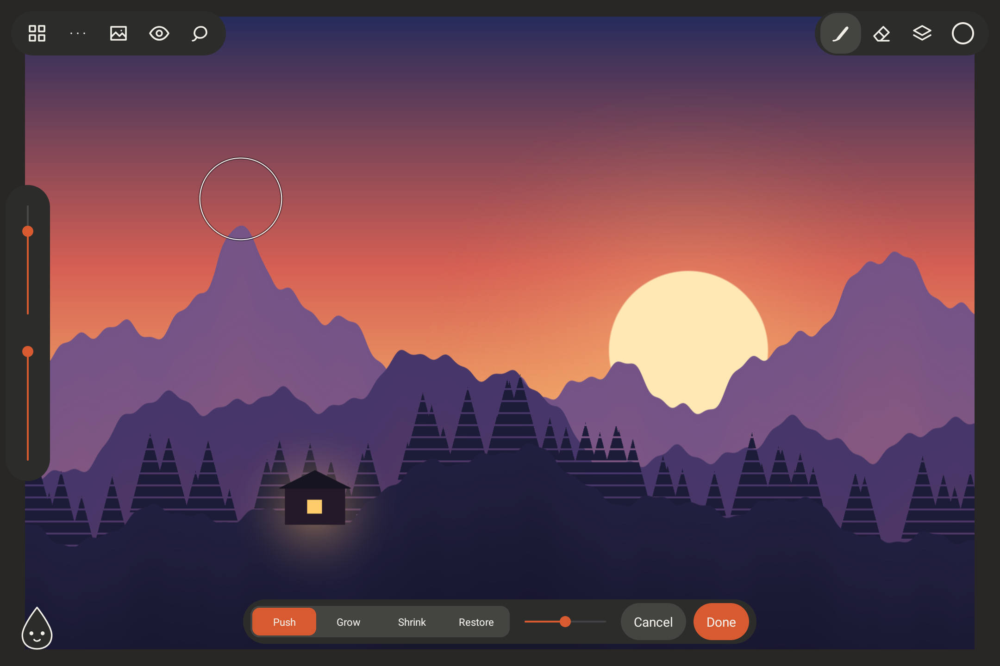 | 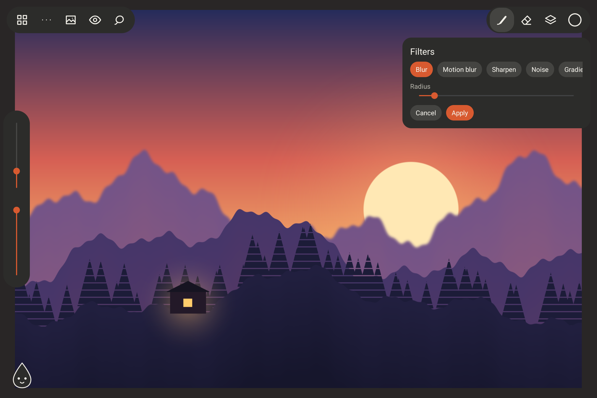 |

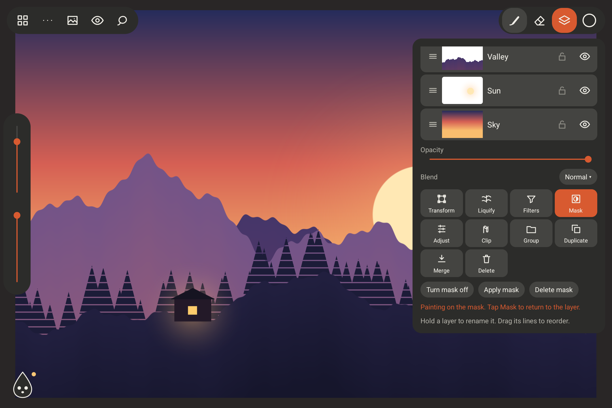

### Direct your art

- Color picker, harmony suggestions, and palettes collected from artwork or references
- Grayscale and value views, canvas flip, and composition guides
- Perspective guides with up to three vanishing points
- Isometric, turnaround view, and thumbnail frame guides
- Light direction and figure height guides

| Art direction | Color |
|---|---|
|  |  |

### Explore options

- Make lettered variations of an artwork and compare them side by side
- Try six color variants at once, then recolor every layer with one tap
- Add text labels to a design sheet
- Export every variation on one page, ready to send to a client

| Color variants | Variations |
|---|---|
| 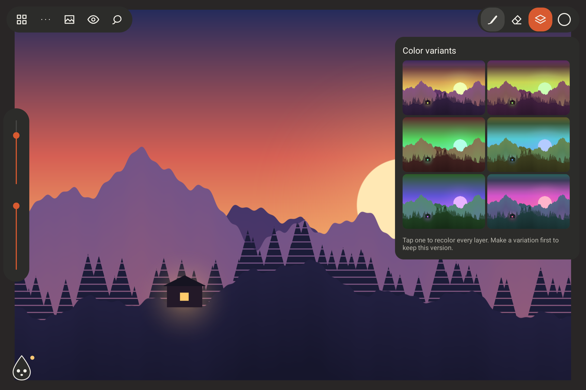 | 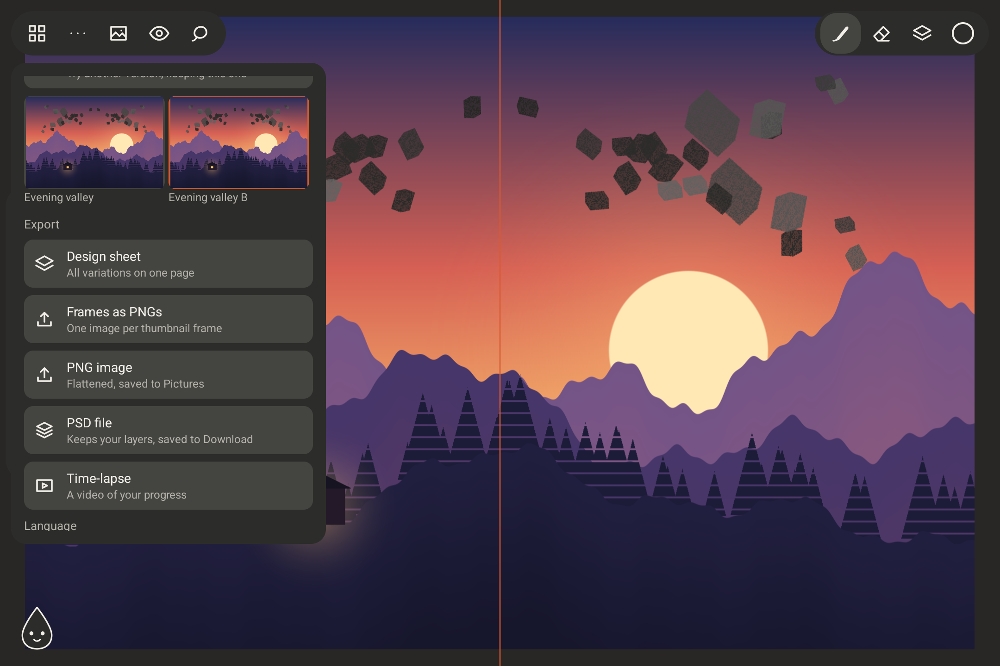 |

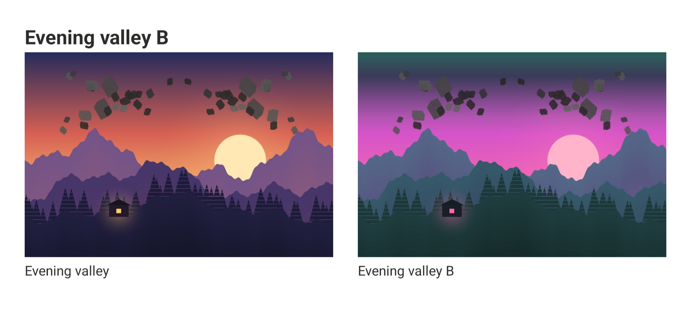

### Work with references

- Sketchbooks, each with its own reference library
- Star your best references, sort them into boards, filter by either, and move them between sketchbooks
- Floating references you can move, zoom, flip, gray out, or pin over your work for tracing
- Pick colors from a reference, or turn it into a palette
- Share images into Cappuccino from other apps

| Floating references | Boards and stars |
|---|---|
|  | 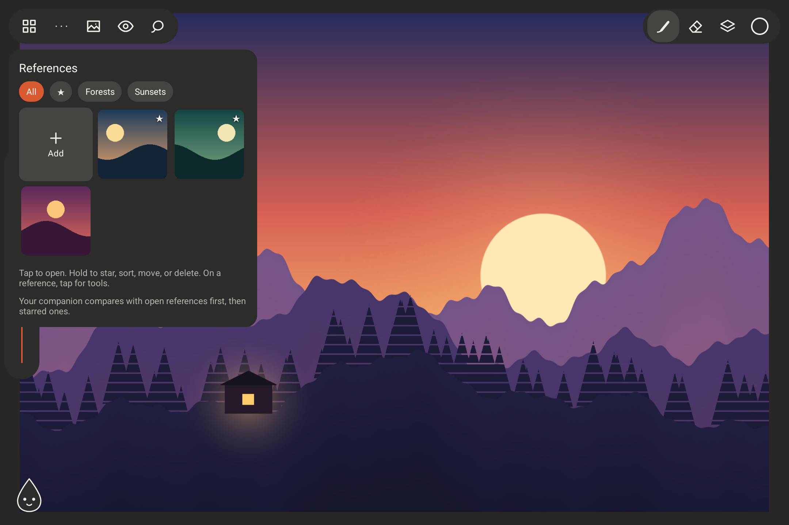 |

### Keep your work

- Automatic saving that writes only the tiles you changed, with the previous version kept
- Finished strokes are written to disk as you draw, and return after a crash
- Export to PNG, layered PSD, and time-lapse video
- Design sheets that put all variations on one page, and a PNG for each thumbnail frame
- PSD import for 8-bit RGB files
- Backup and restore of your whole library in one file
- No ads, accounts, or tracking

## Languages

Cappuccino is available in English and Spanish. It follows your device language, and you can
change it from the home screen under Backup, or from the `...` menu while drawing. To add a
language, add a table to `Translations.kt` and an entry to `Language`.

## Current limits

- After a crash, recovery brings back finished strokes. Layer changes, fills, and filters made in the last few seconds can be lost, and so can a new artwork before its first save.
- Layers use their full size in memory, so very large canvases hold fewer layers.
- PSD files keep layer groups, but layer masks are baked into their layers. Nested groups from other apps become one group.
- Symmetry doesn't apply to smudge.
- Testing has mostly used one device, the XPPen Magic Drawing Pad.

The illustration in these screenshots is original demo art, made for this README.

## Build

Requires Android Studio with its SDK, plus JDK 21. Gradle installs the NDK and CMake.

```bash
./gradlew :app:installDebug
```

## Test

Stroke, fill, and liquify logic, on the computer:

```bash
c++ -std=c++20 -Iengine/src engine/src/stroke.cpp engine/test/stroke_test.cpp -o /tmp/stroke_test && /tmp/stroke_test
```

```bash
c++ -std=c++20 -Iengine/src engine/src/fill.cpp engine/test/fill_test.cpp -o /tmp/fill_test && /tmp/fill_test
```

```bash
c++ -std=c++20 -Iengine/src engine/src/liquify.cpp engine/test/liquify_test.cpp -o /tmp/liquify_test && /tmp/liquify_test
```

App logic, on the computer:

```bash
./gradlew :app:testDebugUnitTest
```

Stylus and tool behavior, on a running emulator. This uninstalls the app afterward, which deletes
its artwork, so don't run it on a device with drawings you want to keep:

```bash
./gradlew :app:connectedDebugAndroidTest
```

See [DESIGN.md](DESIGN.md) for the product and technical design.
