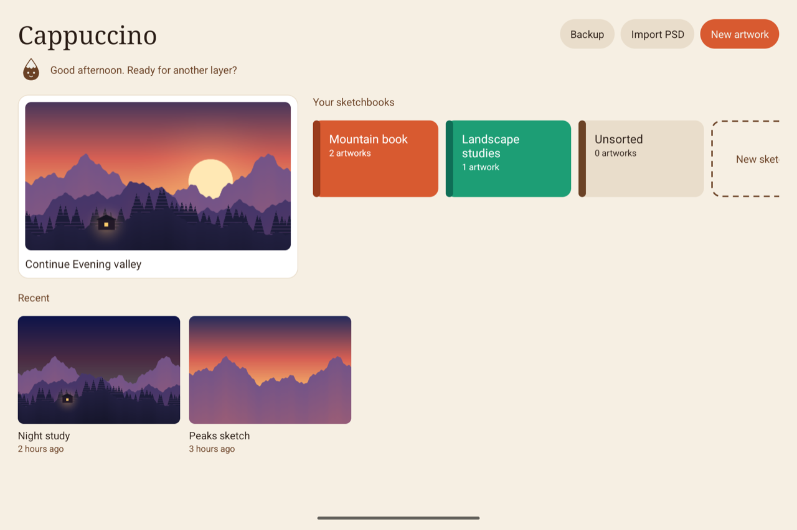
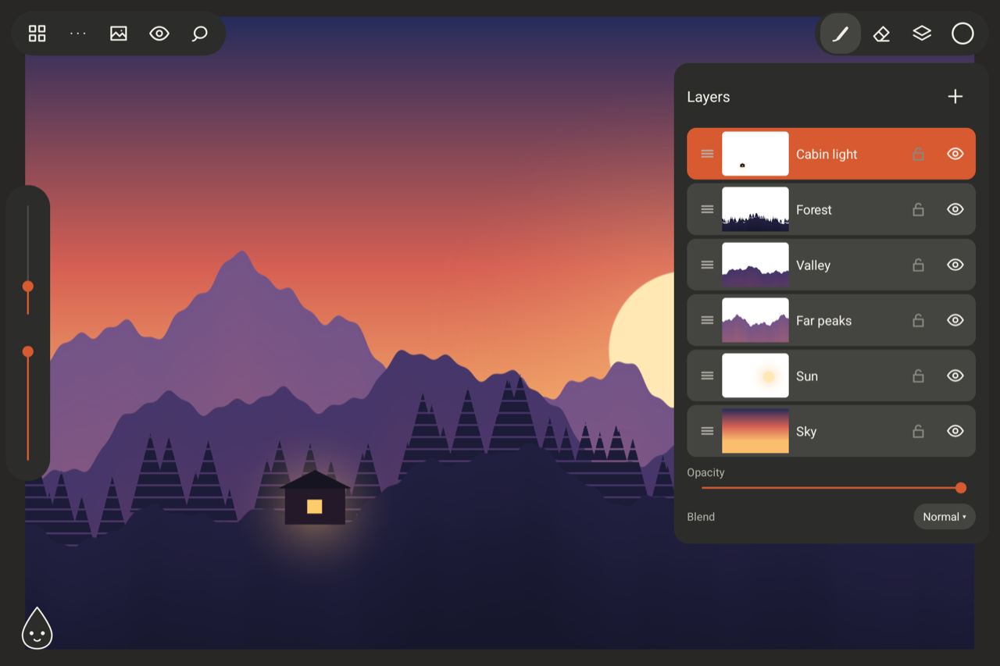
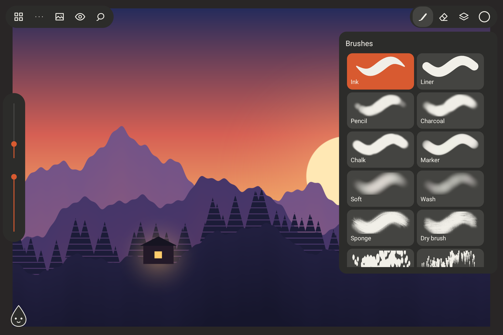
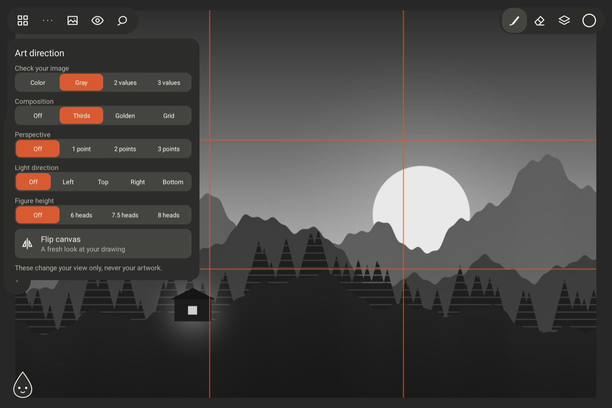
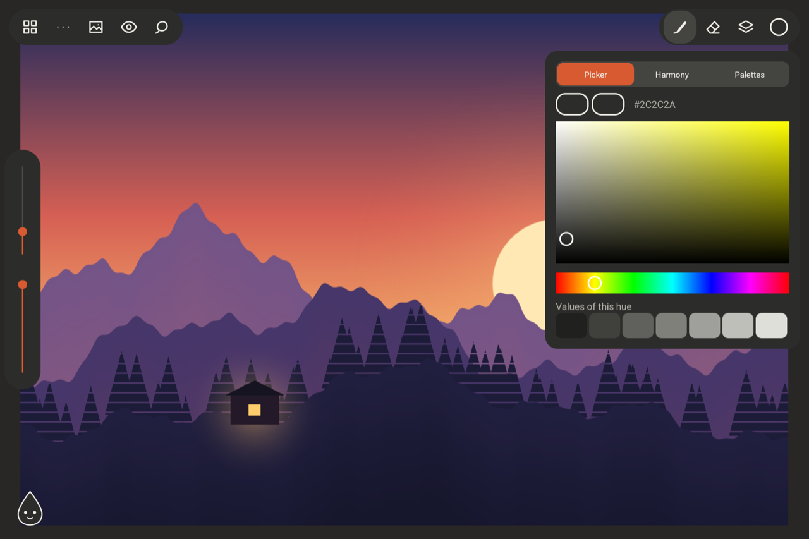
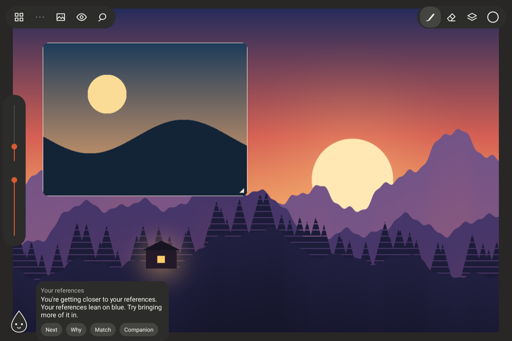

# Cappuccino

A free, ad-free illustration app for Android tablets, made for artists. It stays out of your
way, keeps your work on your device, and adds a small companion that helps with art direction.



Cappuccino is in active development and hasn't had a public release yet.

## Features

### Draw

- Ten brushes, including Sponge and Dry brush textures, plus smudge, fill, and gradient tools
- Custom brushes with imported texture tips, favorites, a stabilizer, and an adjustable pressure curve
- Every brush shape also works as an eraser
- Low-latency stylus drawing with pressure, and tilt on pens that support it
- Hold the pen, or press its side button, to pick a color



### Build your image

- Layers with blend modes, opacity, clipping masks, transparency lock, and groups
- Lasso and magic wand selections, transform, and hue, saturation, and tone adjustments
- One undo history for strokes and layer changes
- Canvas presets for screen, print, and video, or custom sizes up to 8192 pixels



### Direct your art

- Color picker, harmony suggestions, and palettes collected from artwork or references
- Grayscale and value views, canvas flip, and composition guides
- Perspective guides with up to three vanishing points
- Light direction and figure height guides





### Work with references

- Sketchbooks, each with its own reference library
- Floating references you can move, zoom, flip, gray out, or pin over your work for tracing
- Share images into Cappuccino from other apps

### Meet your companion

Choose a paint drop, ink blot, foam cup, or coffee drop. It rests out of the way, never
interrupts you, and only offers a note when you tap it.

**General feedback works on any drawing, with no references needed.** It covers palette, values,
composition, silhouette, and the next step in a sketch. It also covers light and perspective
when those guides are on.

**Reference feedback appears when your artwork's project has reference images.** The companion
compares your artwork with your open references, or with the project's whole library when none
are open. It shows how close your palette, values, composition, and mood are, then suggests
colors to try.

**Why** shows the measurements behind a note. **Idea** suggests something new to explore, such
as a texture pass or an accent color, and **Try it** sets up the tool or color for you.

The companion runs on your device with image analysis, not AI. It never draws for you, and it
can't recognize your subject or judge your style.



### Keep your work

- Automatic saving, with the previous version kept
- Export to PNG, layered PSD, and time-lapse video
- PSD import for 8-bit RGB files
- Backup and restore of your whole library in one file
- No ads, accounts, or tracking

## Languages

Cappuccino is available in English and Spanish. It follows your device language, and you can
change it from the home screen under Backup, or from the `...` menu while drawing. To add a
language, add a table to `Translations.kt` and an entry to `Language`.

## Current limits

- A crash can lose the last few seconds of work.
- Layers use their full size in memory, so very large canvases hold fewer layers.
- Layer groups flatten in PSD files.
- Testing has mostly used one device, the XPPen Magic Drawing Pad.

The illustration in these screenshots is original demo art, made for this README.

## Build

Requires Android Studio with its SDK, plus JDK 21. Gradle installs the NDK and CMake.

```bash
./gradlew :app:installDebug
```

## Test

Stroke and fill logic, on the computer:

```bash
c++ -std=c++20 -Iengine/src engine/src/stroke.cpp engine/test/stroke_test.cpp -o /tmp/stroke_test && /tmp/stroke_test
```

```bash
c++ -std=c++20 -Iengine/src engine/src/fill.cpp engine/test/fill_test.cpp -o /tmp/fill_test && /tmp/fill_test
```

App logic, on the computer:

```bash
./gradlew :app:testDebugUnitTest
```

Stylus and tool behavior, on a running emulator. This uninstalls the app afterward, which deletes
its artwork, so don't run it on a device with drawings you want to keep:

```bash
./gradlew :app:connectedDebugAndroidTest
```

See [DESIGN.md](DESIGN.md) for the product and technical design.
