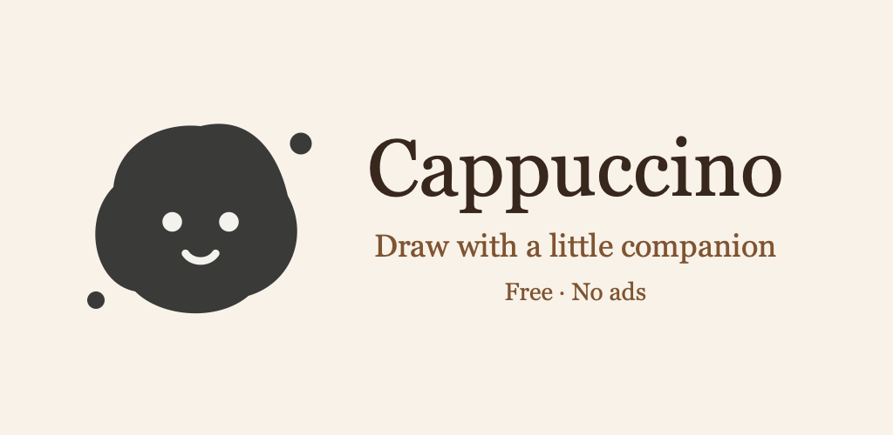
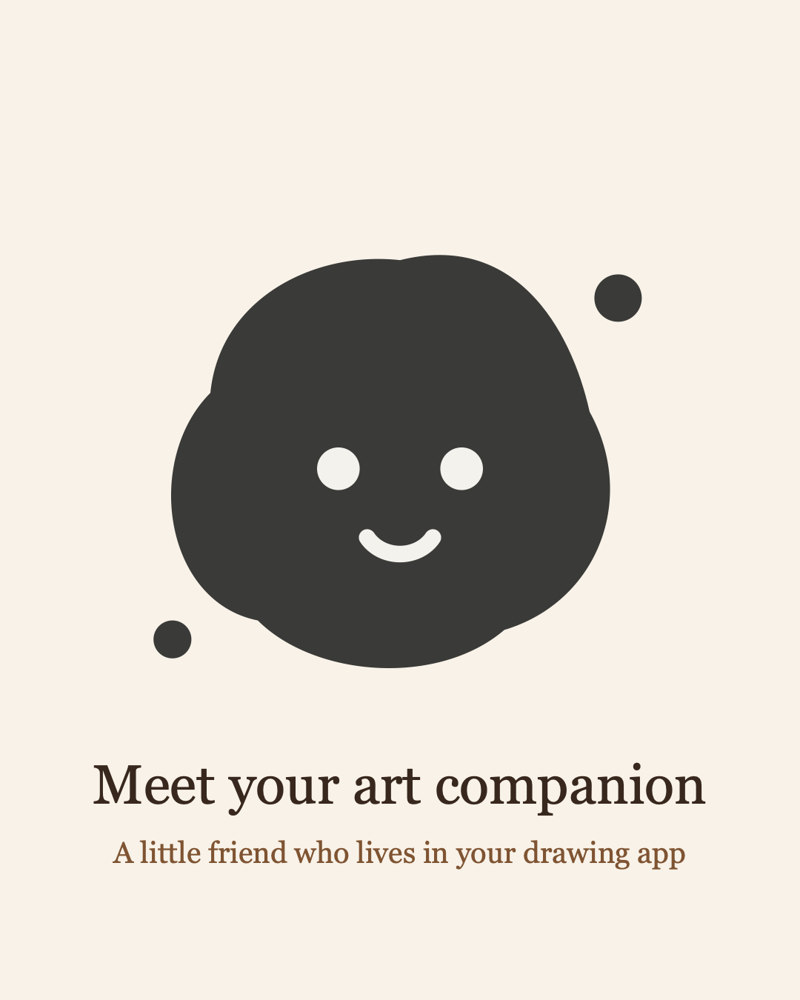
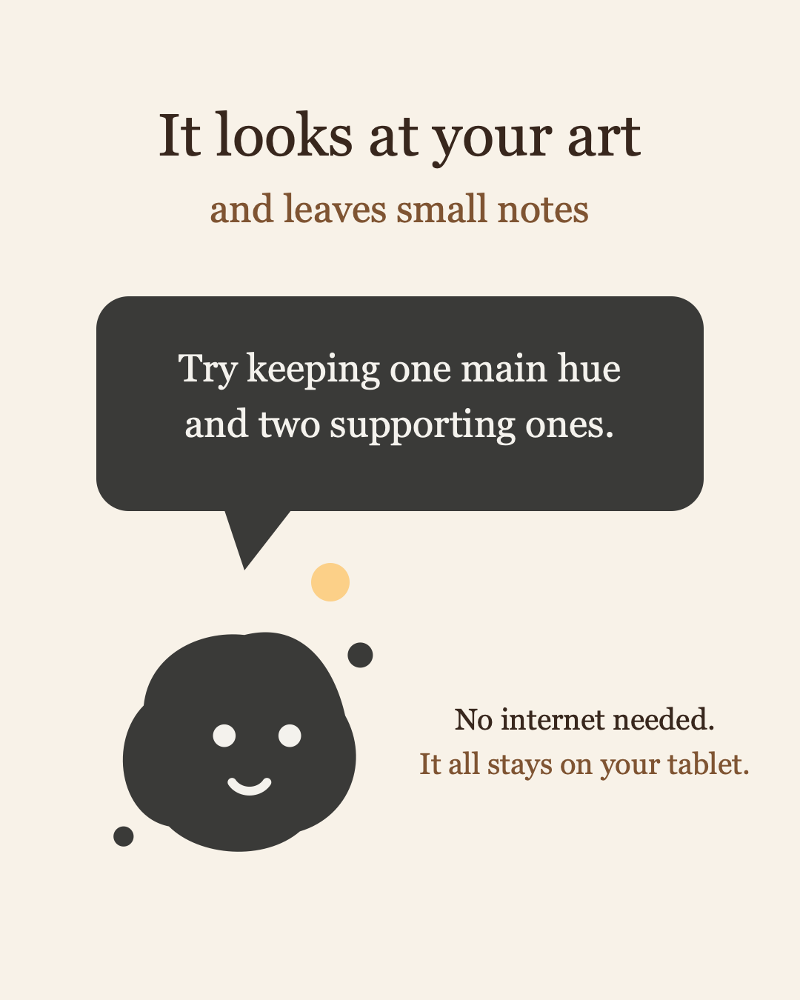
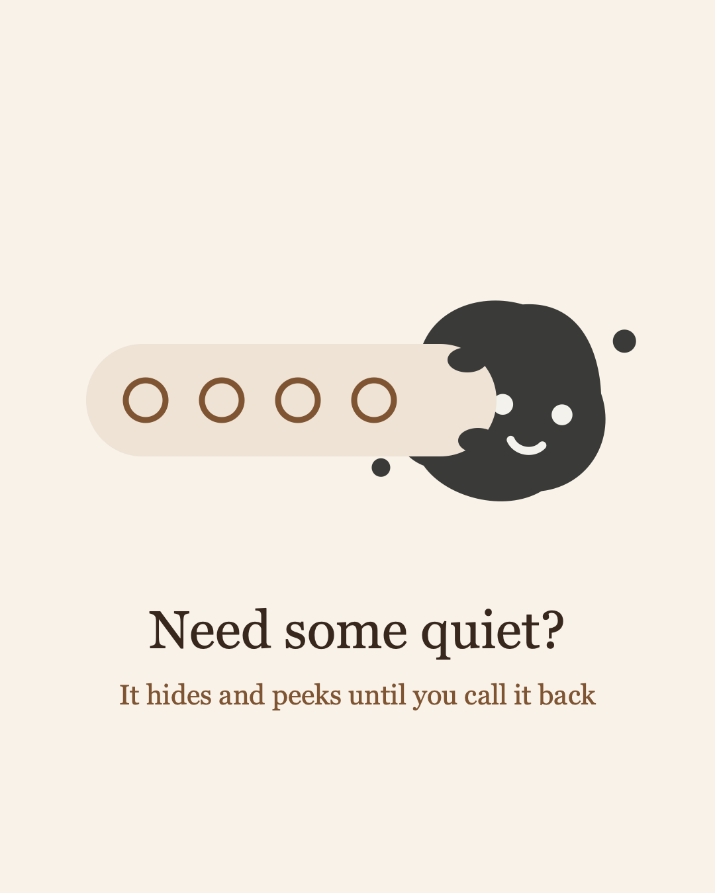
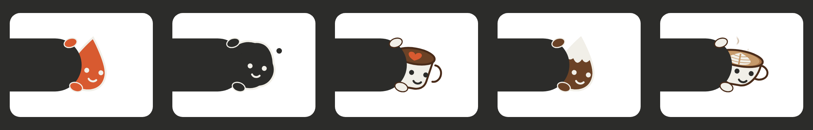
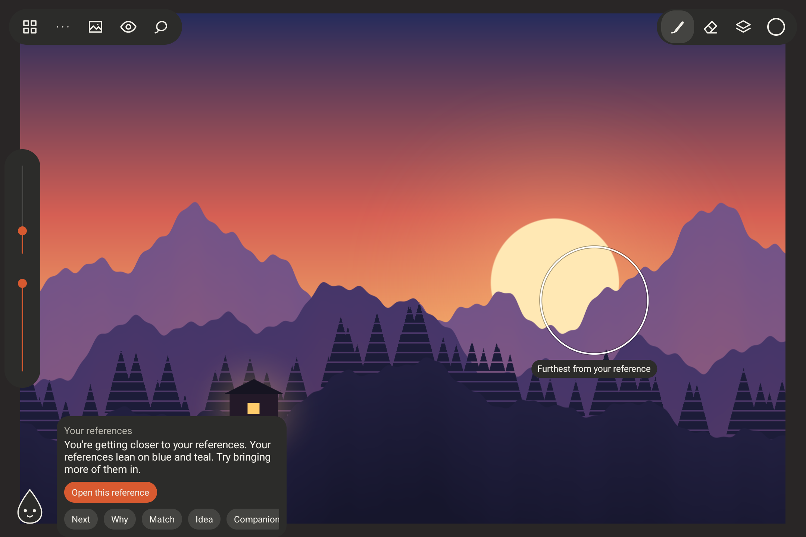
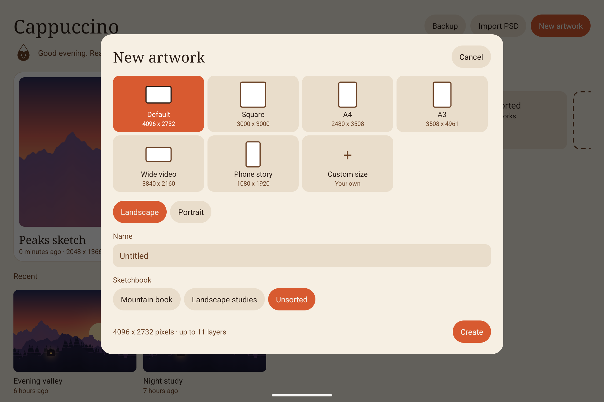
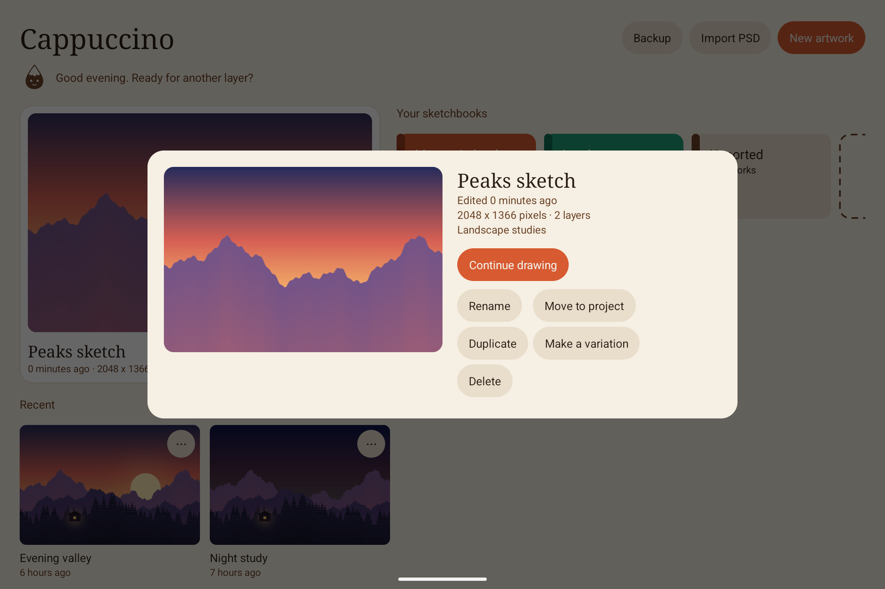

# Cappuccino

A free, ad-free illustration app for Android tablets, with a small companion that gives you art
direction while you work. Your artwork stays on your device, and the interface stays out of your
way until you need it.


Cappuccino is in active development and hasn't had a public release yet.

## Meet your companion

Most drawing apps give you tools and leave you alone with the hard questions. Is this reading
clearly? Are the values working? Am I getting closer to the look I'm after? Cappuccino's
companion is there for those moments, like a friend looking over your shoulder only when you
ask.

<table>
  <tr>
    <td></td>
    <td></td>
    <td></td>
  </tr>
</table>

See it in motion in the [short companion video](marketing/cappuccino-companion-reel.mp4).

Choose a paint drop, ink blot, foam cup, coffee drop, or flat white:


Your companion rests in a corner of the canvas and never interrupts you. When it has a thought, a
small dot appears beside it. Tap it to read the note, or keep drawing and ignore it. If you'd
rather be alone, tap the small button in the corner of its note and it tucks away behind the
toolbar. The flat white keeps steaming while it hides.




### It looks at your drawing

On any artwork, with no setup, the companion looks at your palette, values, composition,
silhouette, and mood, and suggests a next step for your sketch. Turn on a light direction or
perspective guides and it checks those too, including strokes that drift away from your
vanishing points.

### It compares with your references

Add reference images to a sketchbook and the companion measures how close your artwork is to
them. You get a score for palette, values, composition, and mood, plus colors to try from your
references.

You choose what it compares with. Open references come first. If you like, sort the rest into
blocks such as Color palettes, Lights, Composition, Character design, Environment, or Perspective,
or make your own. Each block tells the companion what to read in it, so palette notes only look at
your palettes. An artwork can follow just the blocks you pick. Unsorted references fall back on
your starred ones, then your 40 newest. The note always says what it used.

### It shows its reasoning

The companion never asks you to take its word for it. **Why** shows the measurements behind a
note, with previews of your values, your silhouette, or the closest reference side by side.

### It points to the spot

When you read a note, the companion marks the place it's talking about on your canvas: your
strongest contrast, your visual weight and where to balance it, your silhouette, a line that
drifts from the guide, or the area furthest from your reference. Close the note and the mark is
gone, because it's never part of your artwork.

Every note also takes you one tap from what helps, such as a gray view, the thirds guide, your
colors, or the closest reference.



### It gives you ideas

When you're stuck, **Idea** suggests something to try, such as a texture pass, a bold accent
color, or a Multiply layer for shadows. **Try it** sets up the brush or color for you, so the idea
is one tap from the canvas.

| Why | Match | Idea |
|---|---|---|
|  |  |  |

### It grows with your work

The companion remembers where an artwork was at your last sitting and tells you when it has come a
long way. Its notes follow your stage: shapes while you sketch, values while you block in, color
as you finish. **Not useful** hides a note you don't want, and a topic you keep turning away goes
quiet. **Compare** tells you which variation reads clearest at a small size.

When you export a finished piece, it looks back at how far the piece came since you started it.
**Warm up** on the home screen offers a five-minute exercise aimed at what its notes have been
asking for lately, such as three values or silhouettes only.

### It leaves your art to you

The companion runs entirely on your device with image analysis, not generative AI. Nothing is
uploaded, and it never draws or changes your work. It measures color, light, and shape, so it
can't recognize your subject or judge your style. Those decisions stay yours.

## Features

### Draw

- Sixteen brushes, including Fine and Soft pencils for sketching and Sponge and Dry brush textures
- Scatter brushes for leaves, grass, rocks, and particles
- Smudge, fill, gradient, and lasso fill tools, plus a lasso eraser for blocking in silhouettes
- Hold at the end of a stroke to snap it to a clean line, ellipse, or box. Lines lean toward your perspective guides
- Live symmetry: left-right, top-bottom, four-way, or radial, with a center you can move. Smudge follows it too
- Custom brushes with imported texture tips and scatter settings, favorites, a stabilizer, and a pressure curve for each brush
- Color dynamics: hue variation for each stamp and a slightly different color for each stroke, already on for Leaves, Grass, and Rocks
- Hold at the end of a stroke to snap a clean shape, then drag its handles to adjust it
- Every brush shape also works as an eraser
- Low-latency stylus drawing with pressure, and tilt on pens that support it
- Hold the pen, or press its side button, to pick a color. The side button can erase or undo instead
- Keyboard shortcuts: B brush, E eraser, [ and ] for size, Tab to hide the interface, Ctrl+Z to undo, Ctrl+Shift+Z or Ctrl+Y to redo

| Brushes | Tools and snapping |
|---|---|
|  |  |


### Build your image

- Layers with nine blend modes, multi-select, editable text, opacity, layer masks, clipping masks, transparency lock, and groups
- Liquify: push, grow, shrink, and restore parts of a layer
- Filters: blur, motion blur, sharpen, noise, gradient map, levels, and depth fade
- Import images as new layers, then move, scale, and rotate them into place
- Make a sticker from your drawing: a new top layer with a die-cut border and soft shadow, or a transparent PNG
- Lasso and magic wand selections you can add to or remove from, with a soft edge, plus hue, saturation, and tone adjustments
- Transform with corner handles, or switch to **Distort** and drag each corner on its own to fit a layer into perspective
- Animation: every layer becomes a frame, with onion skin, playback at 4 to 24 frames a second, and video export
- One undo history for strokes and layer changes
- Canvases up to 8192 pixels on a side

| Layers | Layer tools |
|---|---|
|  |  |

| Liquify | Filters |
|---|---|
|  |  |


### Direct your art

- Color picker, harmony suggestions, and palettes collected from artwork or references
- Grayscale and value views, canvas flip, and composition guides
- Perspective guides with up to three vanishing points
- Isometric, turnaround view, and thumbnail frame guides
- Light direction and figure height guides

| Art direction | Color |
|---|---|
|  |  |

### Explore options

- Make lettered variations of an artwork and compare them side by side
- Try six color variants at once, then recolor every layer with one tap
- Add text labels to a design sheet
- Export every variation on one page, ready to send to a client

| Color variants | Variations |
|---|---|
|  |  |


### Work with references

- Sketchbooks, each with its own reference library
- Star your best references, sort them into boards, filter by either, and move them between sketchbooks
- A small tag on each thumbnail shows which block a reference belongs to
- Floating references you can move, zoom, flip, gray out, or pin over your work for tracing
- Pick colors from a reference, or turn it into a palette
- Share images into Cappuccino from other apps

| Floating references | Boards and stars |
|---|---|
|  |  |

### Start and pick up work

- Canvas presets for screen, print, and video, shown in their real proportions, or any custom size
- See how many layers each size can hold before you create it
- Name a new artwork and choose its sketchbook in one step
- Every artwork has its own page with its details, variations, and actions

| New artwork | Artwork details |
|---|---|
|  |  |

### Keep your work

- Automatic saving that writes only the tiles you changed, with the previous version kept
- Finished strokes are written to disk as you draw, and return after a crash
- CMYK sliders and a print preview that show how colors may change on paper, as a close guide without a printer profile
- Export to PNG, layered PSD, animation video, and time-lapse video in the length you choose. Time-lapses end with your companion
- Design sheets that put all variations on one page, and a PNG for each thumbnail frame
- PSD import for 8-bit RGB files
- Backup and restore of your whole library in one file
- No ads, accounts, or tracking

## Languages

Cappuccino is available in English and Spanish. It follows your device language, and you can
change it from the home screen under Backup, or from the `...` menu while drawing. To add a
language, add a table to `Translations.kt` and an entry to `Language`.

## Current limits

- After a crash, recovery brings back finished strokes, fills, and lasso fills. Layer changes and filters made in the last few seconds can be lost.
- Layers use their full size in memory, so very large canvases hold fewer layers.
- PSD files keep layer groups, but layer masks are baked into their layers. Nested groups from other apps become one group.
- Testing has mostly used one device, the XPPen Magic Drawing Pad. Small tablets work, but phone screens are too narrow for the studio's toolbars.

The illustration in these screenshots is original demo art, made for this README.

## Build

Requires Android Studio with its SDK, plus JDK 21. Gradle installs the NDK and CMake.

```bash
./gradlew :app:installDebug
```

## Test

Stroke, fill, and liquify logic, on the computer:

```bash
c++ -std=c++20 -Iengine/src engine/src/stroke.cpp engine/test/stroke_test.cpp -o /tmp/stroke_test && /tmp/stroke_test
```

```bash
c++ -std=c++20 -Iengine/src engine/src/fill.cpp engine/test/fill_test.cpp -o /tmp/fill_test && /tmp/fill_test
```

```bash
c++ -std=c++20 -Iengine/src engine/src/liquify.cpp engine/test/liquify_test.cpp -o /tmp/liquify_test && /tmp/liquify_test
```

App logic, on the computer:

```bash
./gradlew :app:testDebugUnitTest
```

Stylus and tool behavior, on a running emulator. This uninstalls the app afterward, which deletes
its artwork, so don't run it on a device with drawings you want to keep:

```bash
./gradlew :app:connectedDebugAndroidTest
```

See [DESIGN.md](DESIGN.md) for the product and technical design.
